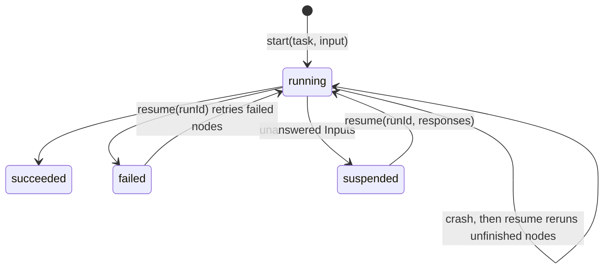

# Proposal: a durable runtime for `@effectory/flow`

`Flow.run` executes a plan in memory. This proposal makes runs durable: a run can stop at an Input, end the process, and continue in a later process when someone responds, without repeating work that already finished.

## Decisions

- **Our own store, not `ClusterWorkflowEngine`.** The cluster engine is heavy (sharding and SQL message storage on one machine) and its model, one sequential workflow function with named activities, doesn't fit our graph of concurrent nodes. We still need our own tables to list pending Inputs and inspect nodes either way.
- **Responding resumes.** Answering Inputs and continuing the run are one step: `resume(task, runId, { responses })`.
- **SQLite** through `@effect/sql-sqlite-bun`, behind a `RunStore` service with an in-memory implementation for tests.

## Key-memoized replay

Node keys are the Task name plus the encoded input, so they are deterministic. Durability is therefore memoization by key, not a positional journal:

- Resuming plans the root again and runs it again. A node whose output is stored under its key returns that output without running its work.
- A call to a key with a stored output returns it immediately.
- An Input is answered from the run's stored responses.

If code changes and a node's key changes, that node runs fresh. Nondeterminism costs repeated work rather than corrupting the run. The exception is Inputs: a changed request is a new question for a person (law I5).

## Run lifecycle

## Phases

Phases 1–6 are implemented; see the Durable runs laws (D1–D8) in the [flow README](../../packages/flow/README.md).

1. **`RunStore` and an in-memory store.** `run` reads and writes node outputs and Input responses through a journal. Stored successes never run again; failures are not memoized, so resuming retries them. Values are stored through each schema's JSON codec.
2. **Lifecycle API.** `Flow.start(task, input)`, `Flow.resume(task, runId, { responses })`, `Flow.status(runId)`. Outcomes (`Succeeded`, `Suspended`, `Failed`) are data with the run id; store and resume problems are errors.
3. **Plan fingerprint.** `start` stores a hash of the static plan (keys and edges). `resume` plans again and refuses a different fingerprint. Called nodes are not in the fingerprint; changing them only makes them run fresh.
4. **Stop at every pending Input.** An unanswered Input blocks its dependents instead of failing the run. Independent branches keep going, and the run suspends once nothing else can progress, listing every pending Input.
5. **SQLite store** with process-level tests: kill a run mid-node and resume (finished nodes don't rerun, the unfinished node runs again); suspend, exit, respond and resume in a new process; refuse a second owner for the same run. Ownership is a lease renewed while running (`Flow.LeaseTime`), so a crashed owner's run can be resumed once it lapses.
6. **Entry point and CLI (done).** `flow.run.ts` default-exports `Flow.make({ tasks, layer })`; the `flow` command in `packages/cli` lists, searches, plans, runs, resumes and inspects its Tasks, with runs in `.effectory/runs.db`.
7. **Later:** retries and timeouts per Task, a concurrency limit, durable timers, and a record of the called nodes that ran.

## Prior art in this repository

- The first runtime used `effect/workflow` on `ClusterWorkflowEngine` with SQLite; see [the research notes](../research/swamp-effect-workflows.md), including its recovery decisions (exactly-once external effects are not guaranteed; encode values through schema codecs).
- The engine removed in `06a2444` (`packages/core/src/engine.ts`, `state.ts`) used its own SQLite run and node rows, and refused to resume after a revision or plan change.
